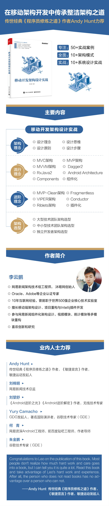

# AppArchitecture

<table>
  <tr>
    <td>
      
    </td>
    <td>
      <b>📖《移动开发架构设计实战》随书源码</b>  
      <ul>
        <li>🛒 购买地址：<a href="https://item.jd.com/12730926.html">京东自营 / 移动开发架构设计实战</a></li>
        <li>⭐ 豆瓣一下：<a href="https://book.douban.com/subject/34872142/">移动开发架构设计实战</a></li>
        <li>📝 勘误与随书说明：<a href="https://blog.imuxuan.com/archives/116">ForDeer 博客</a></li>
        <li>🌐 作者博客：<a href="https://blog.imuxuan.com/">ForDeer</a> · 个人站点：<a href="https://imuxuan.com/">沐暄公益网</a></li>
        <li>🏛️ 学术与馆藏：清华大学、北京大学、中国科学院大学、浙江大学等高校图书馆馆藏 · 河北经贸大学硕士培养方案必读书目（详见下方明细）</li>
      </ul>
    </td>
  </tr>
</table>

## 🏛️ 高校馆藏与培养方案收录

| 机构 / 高校 | 收录类型 | 馆藏地 / 索书号 / 说明 | 核验入口 |
| --- | --- | --- | --- |
| **清华大学图书馆** | 纸本馆藏（在架） | 西馆（逸夫馆）二层科技图书借阅区（西224）· `TN929.53 L324` | [水木搜索](https://discover.lib.tsinghua.edu.cn/entrance/searchEntrance/sortList?query=any,contains,%E7%A7%BB%E5%8A%A8%E5%BC%80%E5%8F%91%E6%9E%B6%E6%9E%84%E8%AE%BE%E8%AE%A1%E5%AE%9E%E6%88%98&tab=default_tab&search_scope=print_scope&vid=86THU) |
| **北京大学图书馆** | 纸本馆藏 | 北大中心馆 · `TP316/1100` | [未名学术搜索](https://pku.summon.serialssolutions.com/#!/search?ho=t&include.ft.matches=f&l=zh-CN&q=9787121375071) |
| **中国科学院大学图书馆** | 纸本馆藏（2 册在架） | 雁栖三层南区流通阅览书库 · `TN929.53/334` | [中科院文献中心](https://www.las.ac.cn/front/book/detail?id=3104950a74f86ba28b92df1c1b567b62) |
| **浙江大学图书馆** | 纸本馆藏（2 册） | 浙江大学图书馆 · `TN929.53/CL105` | 馆藏编目收录 |
| **河北经贸大学** | 硕士培养方案必读书目 | 计算机科学与技术专业硕士学位研究生培养方案必读书目 | [培养方案原文](https://ggw.100xuexi.com/WebSpecF/EnrolDetail.aspx?id=222953) · [百度百科](https://baike.baidu.com/item/%E7%A7%BB%E5%8A%A8%E5%BC%80%E5%8F%91%E6%9E%B6%E6%9E%84%E8%AE%BE%E8%AE%A1%E5%AE%9E%E6%88%98) |
| **更多高校图书馆** | 纸本馆藏 / 新书推荐 | 湖南大学、南京信息工程大学（`TN929.53/920`）、安徽职业技术大学、浙江工商大学、东北林业大学、泉州师范学院、河南城建学院等 | [安职大新书推荐](https://www.uta.edu.cn/tsg/2020/1030/c1800a96515/page.htm) |

## 书籍详情

