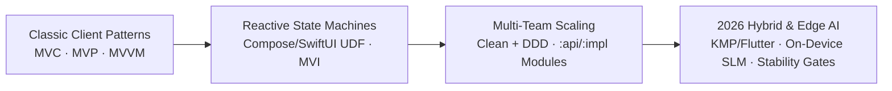

# AppArchitecture — 2026 Mobile Architecture Engineering Playbook & Companion Code

> **Copyright & Independence Notice**:
> - **`playbook/`**: Original, independent 2026 open-source engineering guides for Android, iOS, KMP, Flutter, and On-Device AI authored under the [MIT License](LICENSE).
> - **`Chapter*` directories**: Official companion source code for the Chinese book *《移动开发架构设计实战》* (Publishing House of Electronics Industry, ISBN `9787121375071`). No book chapters or copyrighted book text are reproduced here; please support the published edition via [JD.com](https://item.jd.com/12730926.html) or [Douban](https://book.douban.com/subject/34872142/).

---

## 2026 Open-Source Mobile Architecture Playbook (`playbook/`)

A practical, vendor-neutral reference for mobile tech leads and staff engineers—built to pair directly with [`mobile-agent-skills`](https://github.com/leotyndale/mobile-agent-skills).

| Guide | What You Get | Best Used For |
| --- | --- | --- |
| [**01 · Architecture Decision Matrix**](playbook/01-architecture-decision-matrix.md) | MVC / MVP / MVVM / MVI(UDF) / Clean+DDD trade-offs, ACL mappers & module split criteria | Architecture design reviews & refactors |
| [**02 · Cross-Platform Strategy (2026)**](playbook/02-cross-platform-2026.md) | Pure Native vs KMP vs Flutter (Impeller) vs RN (New Arch) decision tree & typed bridge rules | New product kickoffs & hybrid migrations |
| [**03 · AI-Era Mobile Architecture**](playbook/03-ai-era-mobile-architecture.md) | Hybrid edge-cloud routing, RAM/thermal/binary gates, and prompt-injection safety for local SLMs | Shipping LiteRT / CoreML / AICore features |
| [**04 · Performance & Stability Checklist**](playbook/04-performance-stability-checklist.md) | Startup TTID, 60/120 Hz jank, leak hygiene, ROM crash allowlisting, R8 & binary footprint | Pre-release audits & stability sprints |
| [**05 · Mobile ADR Template**](playbook/05-adr-template.md) | Production Architecture Decision Record template with size/memory/kill-switch gates | RFCs & engineering alignment |

---

## Companion Source Code Index (`Chapter*`)

Reference implementations for classic and modern mobile architectural patterns:
- `Chapter3-MVC` · `Chapter5-MVP` · `Chapter7-MVVM` · `Chapter8-Dagger2` · `Chapter9-RxJava2`
- `Chapter10-AAC` · `Chapter11-CBD` · `Chapter12-Clean` · `Chapter12-Viper` · `Chapter13-Fragmentless` · `Chapter14-Conductor` · `Chapter15-Plugin-Framework`

---

## Academic Recognition (Print Book)

The companion print book *《移动开发架构设计实战》* (recommended by Andy Hunt, co-author of *The Pragmatic Programmer*) is collected by leading Chinese university libraries including **Tsinghua University**, **Peking University**, **University of Chinese Academy of Sciences**, and **Zhejiang University**, and listed as a required graduate reading at **Hebei University of Economics and Business** (see [Chinese README](README.md) for catalog verification links).

---

## Related Open-Source Projects

| Project | Description | Stars |
| --- | --- | --- |
| [**mobile-agent-skills**](https://github.com/leotyndale/mobile-agent-skills) | Production AI Coding Agent Skills for Claude Code, Cursor, Codex, Antigravity & Gemini CLI |  |
| [**EnFloatingView**](https://github.com/leotyndale/EnFloatingView) | Permission-free in-app floating window for Android across all OEM ROMs |  |
| [**EnCrashWhiteList**](https://github.com/leotyndale/EnCrashWhiteList) | Android ROM crash allowlist & defensive governance |  |
| [**EnDebugBubble**](https://github.com/leotyndale/EnDebugBubble) | In-app floating debug panel with live memory & feature toggles |  |

If this playbook helps your mobile team ship cleaner architecture, please give it a **Star ⭐**!
