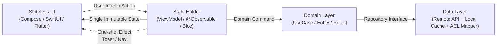

# 01 · Mobile Architecture Decision Matrix (2026 Edition)

> Independent open-source engineering guide. Designed for production Android, iOS, KMP, and Flutter teams choosing presentation and modularization patterns.

## 1. Presentation Pattern Trade-offs (UI <-> State <-> Domain)

| Pattern | State Model | Best Fit | Common Pitfall | Recommended 2026 Adoption |
| --- | --- | --- | --- | --- |
| **MVC** | Mutable controller + imperative view updates | Tiny prototypes, legacy Android `Activity` / UIKit `UIViewController` | Massive View Controller; untestable lifecycle coupling | Legacy maintenance only |
| **MVP** | View interface + Presenter callbacks | Legacy Java/Obj-C apps without reactive UI frameworks | Interface explosion (`Contract` boilerplate); memory leaks if Presenter outlives View | Legacy maintenance only |
| **MVVM** | Observable state properties (`StateFlow`, `@Observable`) | Standard Android Views/Compose & SwiftUI feature screens | Bidirectional binding spaghetti; scattered `MutableStateFlow` mutations | Strong default for CRUD & medium screens |
| **MVI / UDF** | Single immutable `UiState` + sealed `Intent`/`Event` + `Effect` | Complex interactive flows (checkout, feeds, media players, Jetpack Compose / SwiftUI) | Over-engineering trivial static pages; giant monolithic reducer files | **Primary default for Compose / SwiftUI** |
| **Clean + Modular DDD** | Domain entities + UseCases + `:api`/`:impl` bounded contexts | Multi-team apps (> 50k LOC, > 5 engineers, shared KMP domain) | Pass-through `UseCase` bloat adding indirection without business rules | **Essential for scaling teams & build speed** |

## 2. Unidirectional Data Flow (UDF) Reference Topology

### Non-Negotiable Rules
1. **Single Source of Truth**: One screen renders from one immutable state snapshot (`UiState`), never 6 independent `LiveData`/`Published` booleans that can enter impossible combinations (`isLoading = true` AND `error != null`).
2. **State vs. Effect Separation**: Dialogs, navigation triggers, and snackbars are either consumed events in state or single-consumer effect streams (`Channel` / consumed IDs)—never re-fired on screen rotation.
3. **Anti-Corruption Layer (ACL)**: Backend JSON DTOs and local DB entities stay inside `:data`; map them into clean domain models before reaching UI.

## 3. When to Split a Module (`:api` vs `:impl`)

Create a separate Gradle/SPM/Melos module when **at least two** apply:
- Incremental build time for the feature exceeds ~15 seconds and touches shared code.
- Multiple feature squads need to depend on a capability without pulling in its UI/SDK transitive graph.
- You want compile-time enforcement preventing `feature-A` from reaching into `feature-B`'s internal ViewModels or tables.

Skip splitting when a module would contain < 3 files and zero independent tests—premature micro-modules hurt navigation and review velocity.
