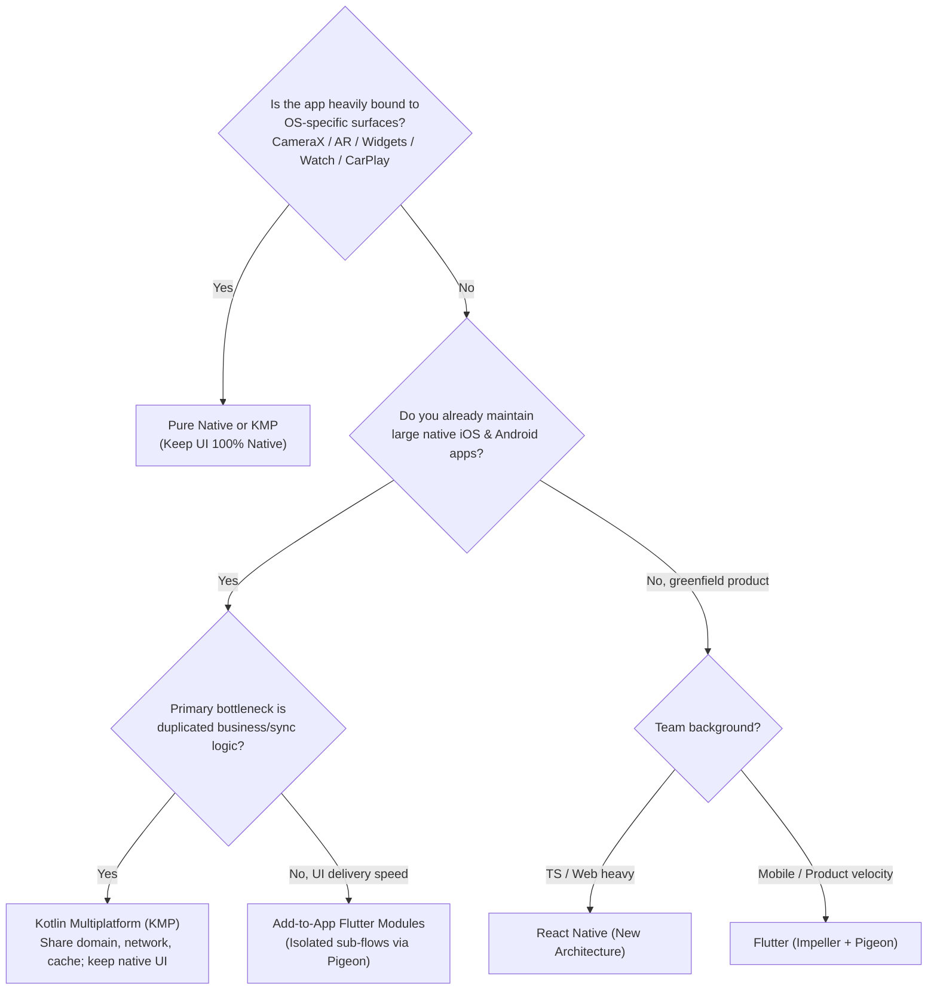

# 02 · Cross-Platform Strategy Matrix (2026 Edition)

> Independent engineering trade-off framework for deciding between Pure Native, Kotlin Multiplatform (KMP), Flutter, React Native (New Architecture), and Web/Mini-App hybrids.

## 1. Strategic Comparison

| Dimension | Pure Native (Compose + SwiftUI) | Kotlin Multiplatform (KMP + Native UI) | Flutter (Impeller) | React Native (New Arch / Fabric) |
| --- | --- | --- | --- | --- |
| **UI Fidelity & OS Integration** | ★★★★★ (Day-0 OS APIs, widgets, Live Activities, CarPlay) | ★★★★★ (Native Compose & SwiftUI UI) | ★★★★☆ (Consistent custom canvas; slight lag on brand-new OS chrome) | ★★★★☆ (Native views via Fabric, bridge-less JSI) |
| **Code Sharing Scope** | Low (shared specs/protos only) | **Business logic, networking, DB, state** (40%–70%) | **UI + Business logic** (85%–95%) | **UI + Business logic** (80%–90% + web synergy) |
| **Binary Size Overhead** | Baseline (smallest) | +2–5 MB on iOS (`Kotlin/Native` framework) | +8–15 MB engine + Dart AOT | +6–12 MB Hermes + RN runtime |
| **Team Skill Fit** | Separate Android & iOS teams | Android-strong orgs adopting iOS cleanly | Dedicated Flutter/Dart product teams | TypeScript/React full-stack teams |
| **Incremental Add-to-App Risk** | N/A | **Very Low** (consumes like a normal `.xcframework` / `.aar`) | Medium (`FlutterEngineGroup` memory & navigation handoff) | Medium (Metro + native dependency alignment) |

## 2. Decision Flowchart

## 3. Practical Guardrails for Hybrid & Cross-Platform Apps

1. **Standardize Typed Bridges**: Replace ad-hoc string `MethodChannel` calls with code-generated contracts (**Pigeon** for Flutter, **UniFFI** for Rust, **SKIE** for KMP Swift interop).
2. **Isolate Platform Views**: Avoid stacking dozens of `AndroidView` / `UiKitView` inside scrolling feeds; native platform views bypass Impeller/Skia compositing optimizations and can degrade frame pacing.
3. **Observability Parity**: Ensure crash reporting, startup TTID, and custom tracing correlate cross-platform frames (Dart/JS stack + native frames) under a single release version and symbol upload pipeline.
