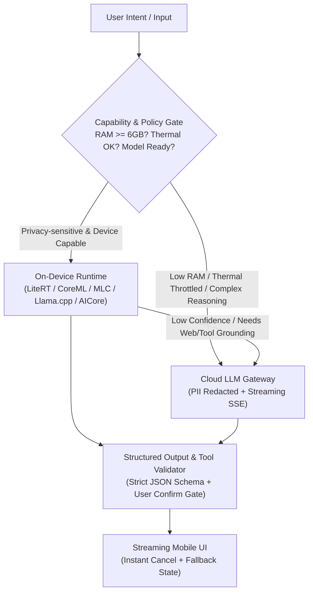

# 03 · AI-Era Mobile Architecture (On-Device & Hybrid Edge-Cloud)

> Independent engineering guide for architecting on-device SLMs, local vision/embedding pipelines, and agentic mobile UX without OOMs, thermal throttling, or privacy leaks.

## 1. Hybrid Edge-Cloud Routing Architecture

Never treat on-device AI as "always run locally" or cloud AI as "send everything over the network." Route dynamically based on device tier, thermal headroom, connectivity, and privacy sensitivity:

## 2. Five Production Constraints Unique to Mobile AI

| Constraint | Failure Mode in Production | Required Architectural Pattern |
| --- | --- | --- |
| **Base Binary Size** | Bundling a 400 MB–2 GB model breaks Play/App Store cellular download limits | Use **Play Asset Delivery** / **Apple On-Demand Resources** or resumable CDN download with **SHA-256 verification** |
| **Memory Pressure (OOM)** | Holding KV-cache + weights in RAM alongside camera/feeds triggers `lmkd` / Jetsam kill | Gate by physical RAM tier; lazily load off main thread; release native sessions on `onTrimMemory()` / `didReceiveMemoryWarning` |
| **Thermal Throttling** | Continuous NPU/GPU inference heats SoC -> OS throttles CPU -> UI janks | Monitor `PowerManager.getCurrentThermalStatus()` / `ProcessInfo.thermalState`; downgrade token budget or offload to cloud at `MODERATE`/`SEVERE` |
| **Prompt Injection via App Surfaces** | Push notification, QR code, or WebView text hijacks local agent tool calls | Treat external app inputs as untrusted; enforce allowlisted tool schemas and require explicit biometric/tap confirmation for state-changing actions |
| **Evaluation Blindness** | Only testing latency on a flagship developer phone with 16 GB RAM | Measure **TTFT**, **tokens/sec**, and **peak RSS** on 4 GB / 6 GB mid-tier devices under background memory load |

## 3. Recommended Telemetry (Privacy-Safe)

Log **operational** metrics only—never raw user prompts or PII:
- `ai_route_selected` (`on_device_npu` | `on_device_cpu` | `cloud_fallback` | `deterministic_fallback`)
- `ai_ttft_ms`, `ai_decode_tps`, `ai_peak_rss_mb`
- `ai_thermal_state_at_start`, `ai_cancelled_by_user`
